<p align="center">
  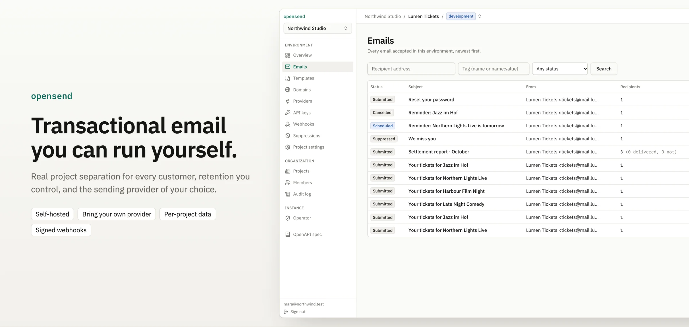
</p>

<p align="center">
  <a href="https://github.com/darkooom/OpenSend/actions/workflows/ci.yml"></a>
  <a href="https://nodejs.org/"></a>
  <a href="https://nestjs.com/"></a>
  <a href="https://nextjs.org/"></a>
  <a href="https://www.typescriptlang.org/"></a>
  <a href="https://www.postgresql.org/"></a>
  <a href="#license"></a>
</p>

<p align="center">
  <a href="#quick-start"><b>Quick start</b></a>
  &nbsp;·&nbsp;
  <a href="docs/API.md"><b>API reference</b></a>
  &nbsp;·&nbsp;
  <a href="docs/SELF_HOSTING.md"><b>Self-hosting</b></a>
  &nbsp;·&nbsp;
  <a href="docs/ARCHITECTURE.md"><b>Architecture</b></a>
  &nbsp;·&nbsp;
  <a href="CONTRIBUTING.md"><b>Contributing</b></a>
</p>

<br>

Agencies and SaaS teams send email for many customers at once. Most email services treat
that as one big account: one pile of keys, one suppression list, one retention policy, one
vendor you cannot leave.

**OpenSend gives every customer its own project**, with separate environments, domains,
API keys, provider connection, templates, webhooks, suppressions, usage and retention.
You run it on your own infrastructure and connect the sending provider you already have.
Nothing calls home, nothing is locked behind a license key.

<p align="center">
  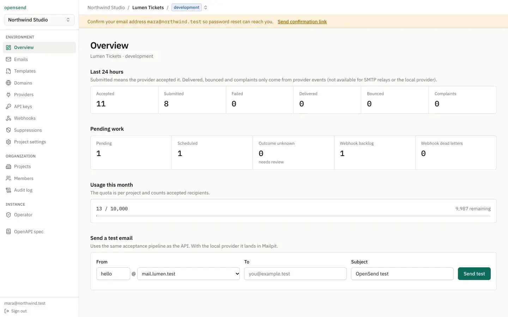
</p>

> **Status: pre-release.** The full local flow works and is covered by tests, but the Amazon
> SES adapter has not been verified against a real account yet. See
> [Implementation status](docs/IMPLEMENTATION_STATUS.md).

## Quick start

Requirements: Node.js 24, Docker, and pnpm through Corepack.

```bash
git clone https://github.com/darkooom/OpenSend.git
cd OpenSend
corepack enable
pnpm install --frozen-lockfile
pnpm setup:local      # writes .env with random local secrets
pnpm services:up      # PostgreSQL, Redis, MinIO, Mailpit
pnpm build && pnpm db:migrate
pnpm bootstrap:token  # one-time setup token, valid 60 minutes
pnpm dev              # API :3001 · worker · dashboard :3000
```

Open <http://localhost:3000/setup>, paste the token and create the first owner. Then create a
project, pick **Local (Mailpit)** as provider, add a domain such as `myapp.test`, create an
API key and send:

```bash
curl -X POST http://localhost:3001/v1/emails \
  -H "Authorization: Bearer $OPENSEND_API_KEY" \
  -H "Idempotency-Key: welcome-42" \
  -H "Content-Type: application/json" \
  -d '{"from":"My App <hello@myapp.test>","to":"you@example.test","subject":"Hello","text":"It works."}'
```

The message arrives in Mailpit at <http://localhost:58025>. Local mail never leaves your machine.

## What's inside

<table>
  <tr>
    <td width="50%" valign="top">
      <b>Real project separation</b><br>
      Organization → project → environment. Keys, domains, providers, templates, webhooks, suppressions and data never cross a project boundary.
    </td>
    <td width="50%" valign="top">
      <b>Durable acceptance</b><br>
      <code>202</code> means committed to PostgreSQL in one transaction, with idempotency keys enforced by a unique constraint, quota reserved and the outbox written.
    </td>
  </tr>
  <tr>
    <td valign="top">
      <b>Honest delivery states</b><br>
      <i>Submitted</i> is never shown as <i>delivered</i>. Delivery, bounce and complaint are tracked per recipient from signed provider events. Unclear hand-offs become <code>submission_unknown</code> and are never resent blindly.
    </td>
    <td valign="top">
      <b>Bring your own provider</b><br>
      Mailpit for local development, any TLS SMTP relay, or Amazon SES with SNS events. Each provider declares what it can do, and nothing is faked.
    </td>
  </tr>
  <tr>
    <td valign="top">
      <b>Data you control</b><br>
      Retention per project for content, attachments and metadata, including a mode without a long-term content archive. Content, attachments and credentials are encrypted with AES-256-GCM.
    </td>
    <td valign="top">
      <b>Built for teams and agencies</b><br>
      Owner, admin, developer and viewer roles, members limited to selected projects, short-lived invitations, an audit log and operator pause.
    </td>
  </tr>
</table>

## Product tour

### Overview

Real numbers only: what was accepted, submitted and failed, what is still pending, and what
needs attention. The first-run checklist disappears once the environment can send.

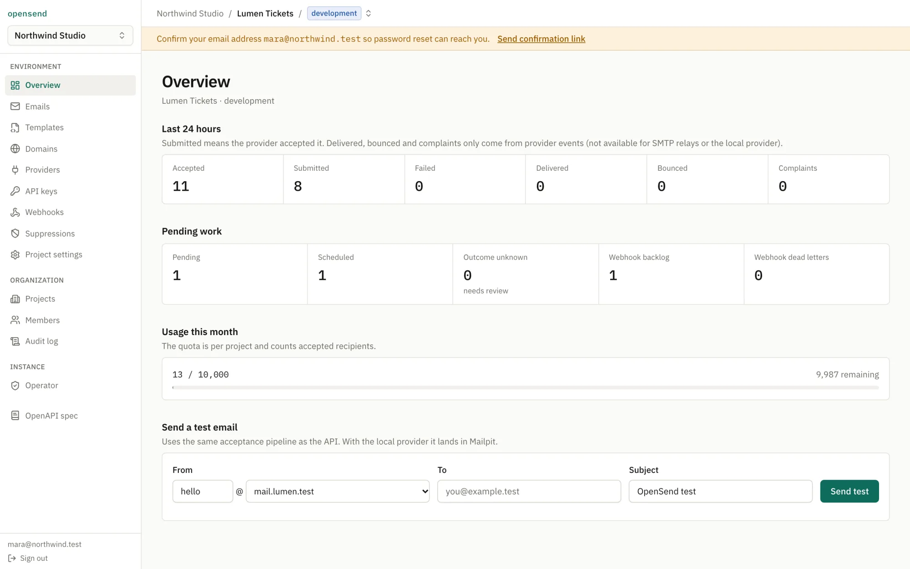

<table>
  <tr>
    <td width="50%" valign="top">
      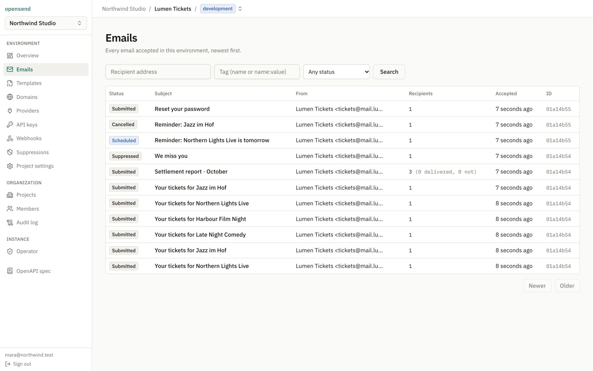
      <p align="center"><b>Emails</b><br><sub>Search by recipient, tag or status. Scheduled, cancelled and suppressed are first-class states</sub></p>
    </td>
    <td width="50%" valign="top">
      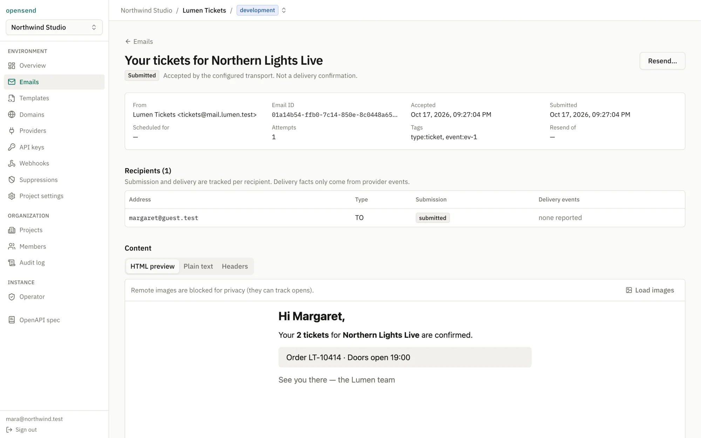
      <p align="center"><b>Email detail</b><br><sub>Every recipient on its own row, with submission and delivery kept apart</sub></p>
    </td>
  </tr>
  <tr>
    <td valign="top">
      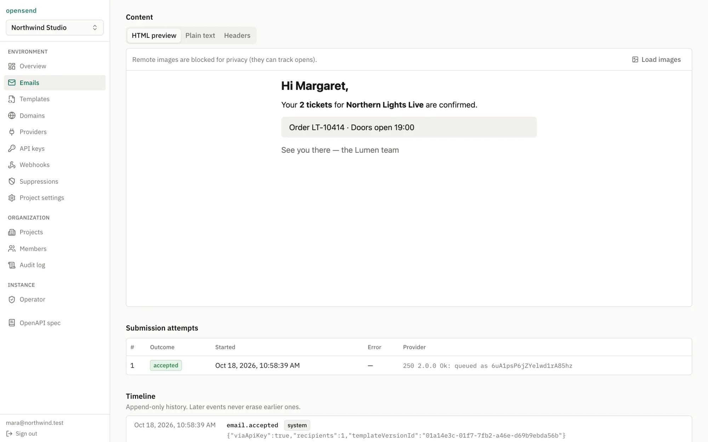
      <p align="center"><b>Preview, attempts, timeline</b><br><sub>HTML in a script-free sandbox, remote images blocked, append-only history</sub></p>
    </td>
    <td valign="top">
      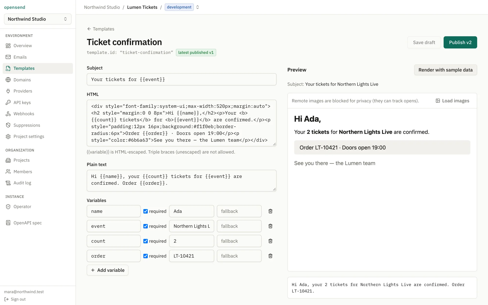
      <p align="center"><b>Templates</b><br><sub>Draft, preview with sample data, publish immutable versions</sub></p>
    </td>
  </tr>
  <tr>
    <td valign="top">
      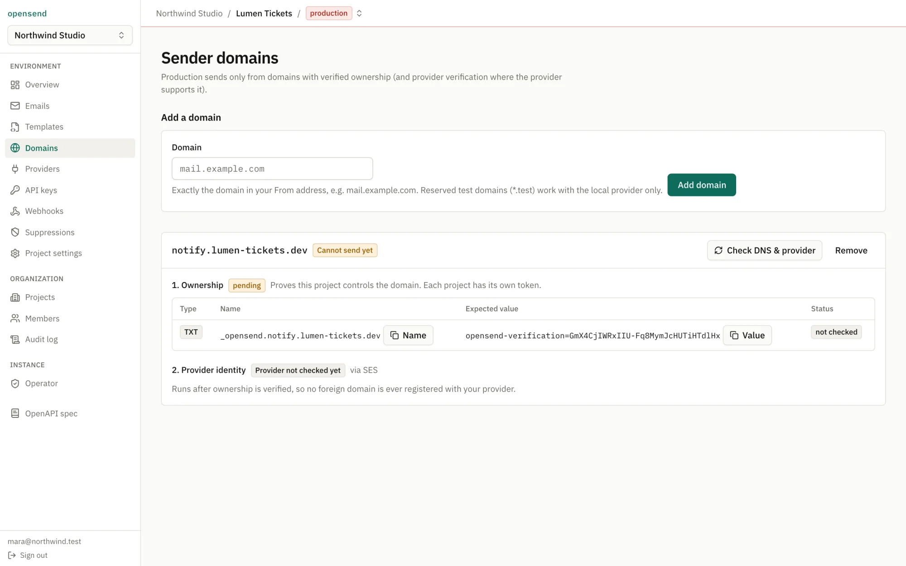
      <p align="center"><b>Domains</b><br><sub>Ownership proof, provider identity and SPF/DMARC diagnostics, kept apart</sub></p>
    </td>
    <td valign="top">
      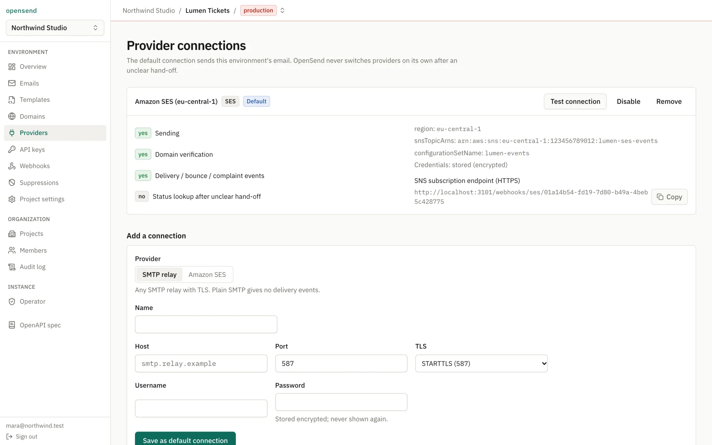
      <p align="center"><b>Providers</b><br><sub>Explicit capabilities, encrypted credentials, connection test</sub></p>
    </td>
  </tr>
  <tr>
    <td valign="top">
      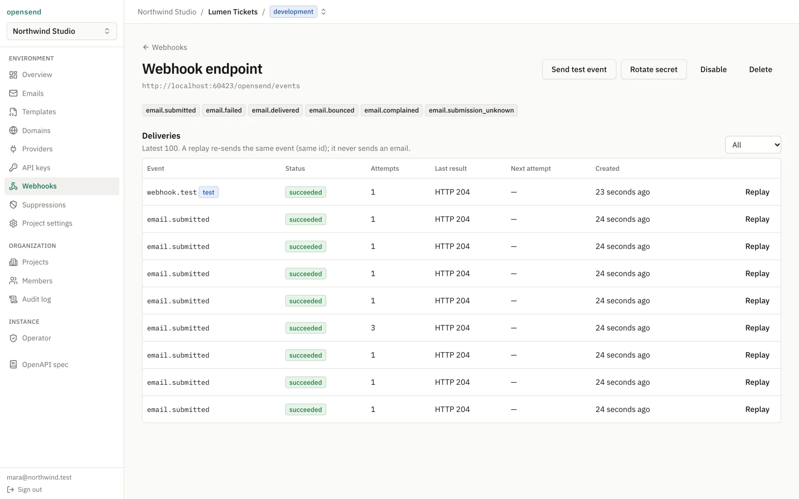
      <p align="center"><b>Webhooks</b><br><sub>Signed, retried with backoff, dead-lettered, replayable</sub></p>
    </td>
    <td valign="top">
      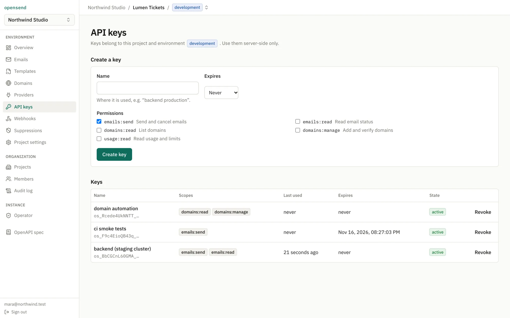
      <p align="center"><b>API keys</b><br><sub>Per environment, scoped, expiring, shown exactly once</sub></p>
    </td>
  </tr>
  <tr>
    <td valign="top">
      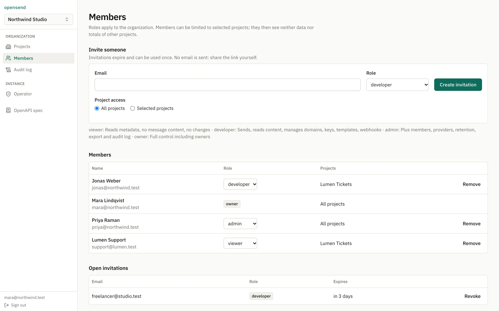
      <p align="center"><b>Members</b><br><sub>Roles plus access limited to selected projects</sub></p>
    </td>
    <td valign="top">
      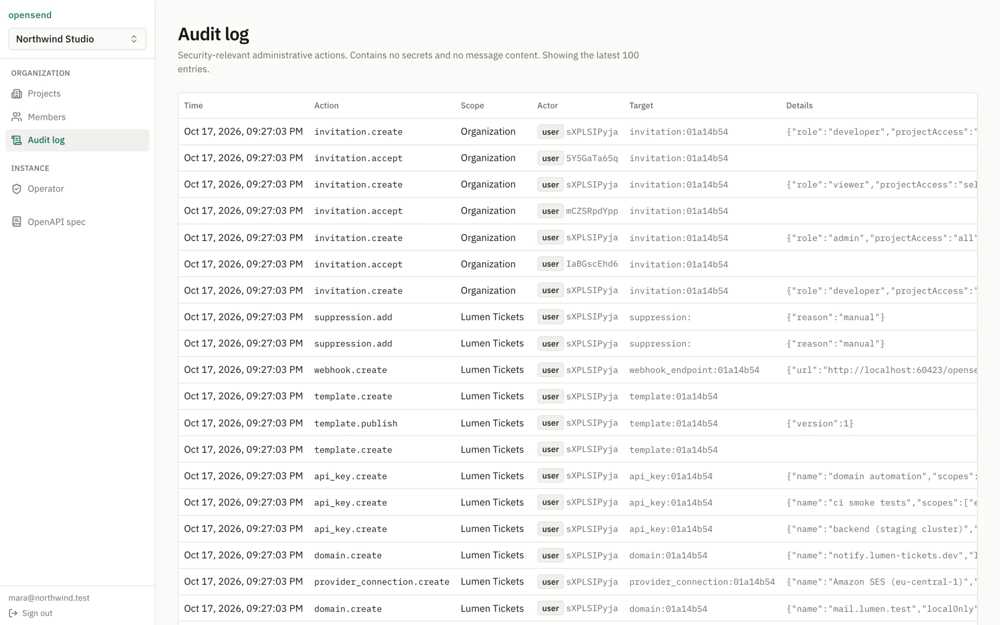
      <p align="center"><b>Audit log</b><br><sub>Who did what, to which target, from where, without secrets</sub></p>
    </td>
  </tr>
  <tr>
    <td valign="top">
      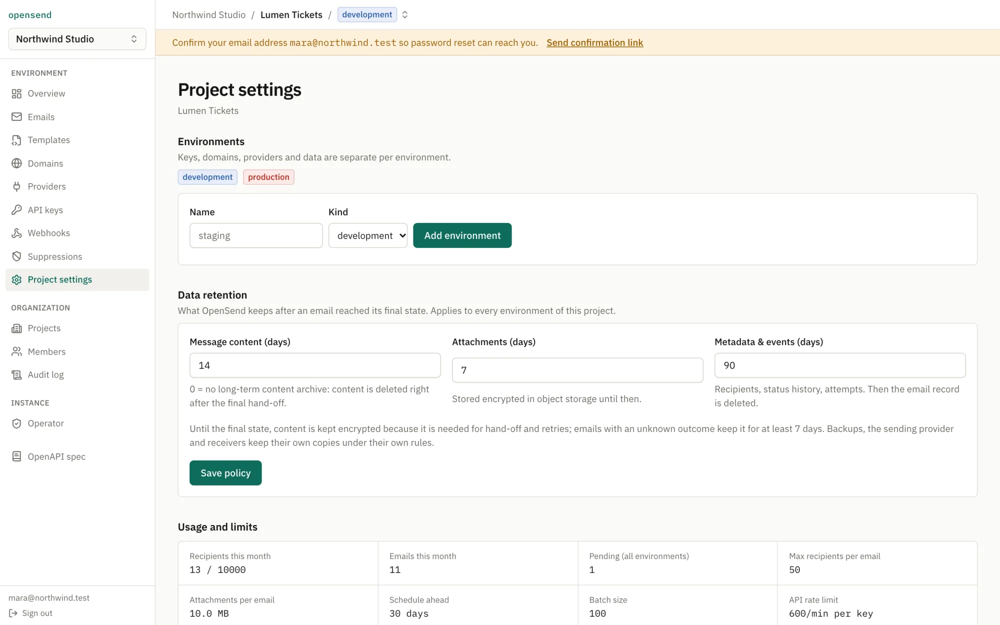
      <p align="center"><b>Retention &amp; export</b><br><sub>Per-project policy, limits at a glance, NDJSON export</sub></p>
    </td>
    <td valign="top">
      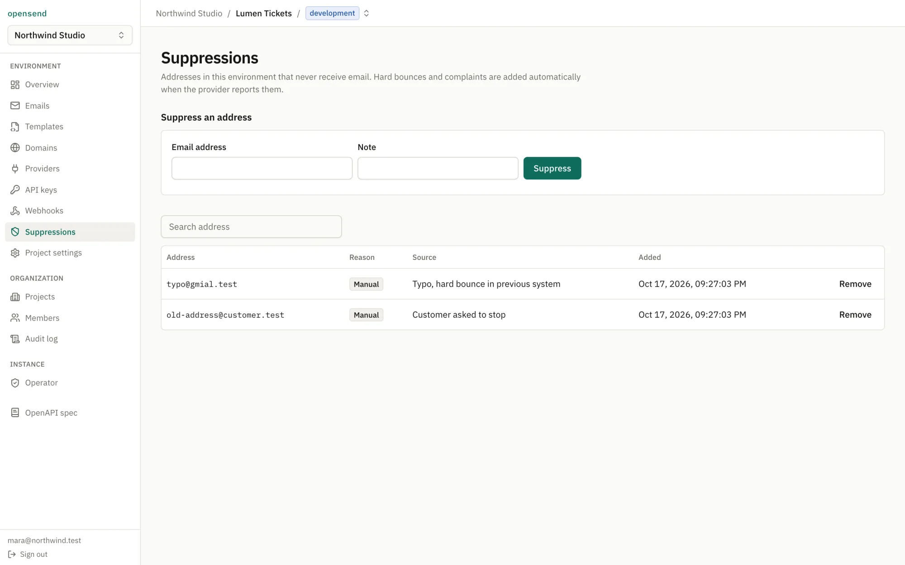
      <p align="center"><b>Suppressions</b><br><sub>Hard bounces and complaints added automatically</sub></p>
    </td>
  </tr>
</table>

### Designed for the unhappy path too

Empty results say why they are empty and offer a way out. Loading uses skeletons shaped like
the final table. Errors name what failed and offer a retry.

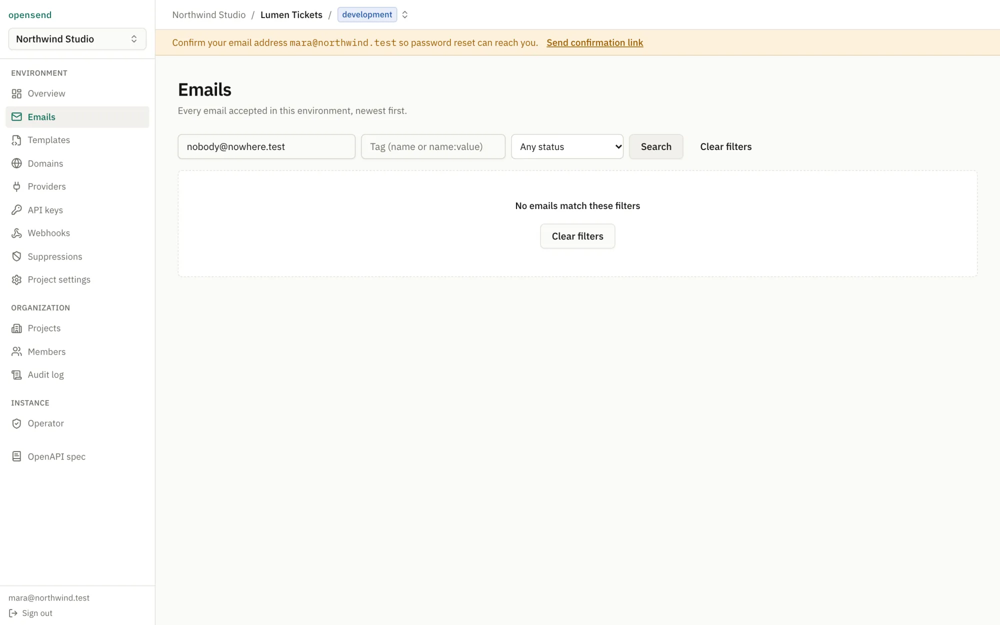

### Responsive down to the phone

<p align="center">
  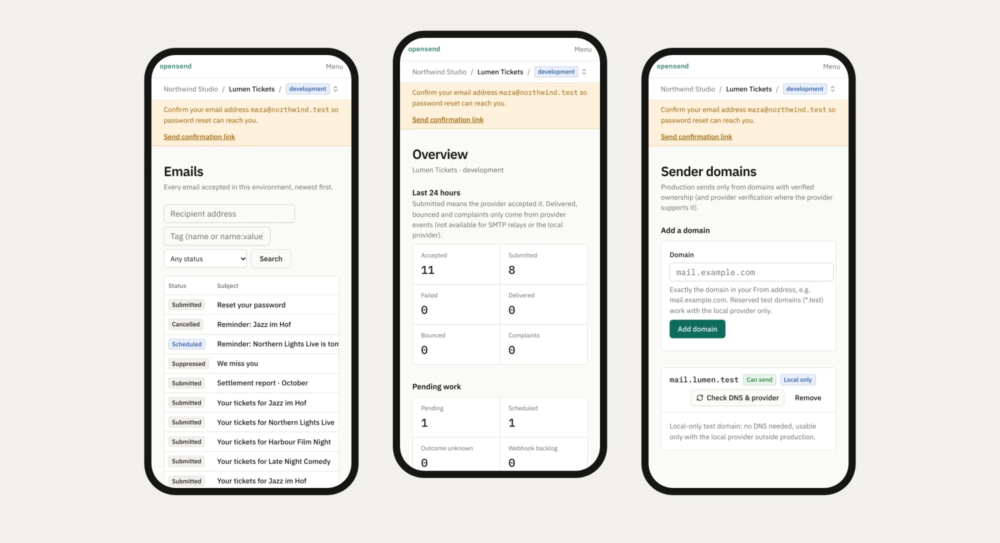
</p>

<sub>All screenshots come from a local instance with fictional sample data and are regenerated
with <code>pnpm readme:screenshots</code>.</sub>

## How it works

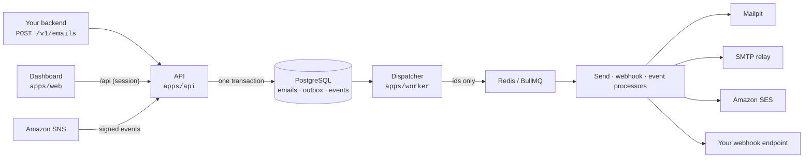

PostgreSQL is the source of truth. If Redis loses its data, the dispatcher rebuilds the queue
from the outbox. If a worker dies mid hand-off, its lease expires and the email becomes
`submission_unknown`, so it is never sent twice by accident.

```text
accepted → queued → submitting → submitted
   ↓         ↑                 ↘ retry_wait → submitting
scheduled ───┘                 ↘ failed
   ↓                           ↘ submission_unknown   (never retried automatically)
cancelled  (only before hand-off)
```

## Providers

| Provider           | Sending | Domain verification | Delivery events | Status lookup | Verified with    |
| ------------------ | :-----: | :-----------------: | :-------------: | :-----------: | ---------------- |
| Local (Mailpit)    |    ✓    |     not needed      |        –        |       ✓       | real Mailpit     |
| Generic SMTP (TLS) |    ✓    |    relay-managed    |        –        |       –       | unit tests       |
| Amazon SES         |    ✓    |  ✓ (DKIM via SES)   |     ✓ (SNS)     |       –       | SDK test doubles |

A capability a provider does not have is shown as missing, never simulated. OpenSend never
switches providers on its own after an unclear hand-off.

## Use it from your code

```ts
import { OpenSend } from '@opensend/sdk';

const opensend = new OpenSend({
  apiKey: process.env.OPENSEND_API_KEY!,
  baseUrl: 'https://mail.example.com',
});

const { id, status } = await opensend.emails.send(
  {
    from: 'Acme <hello@mail.acme.com>',
    to: 'ada@example.com',
    template: { id: 'welcome', variables: { name: 'Ada' } },
  },
  { idempotencyKey: `welcome-${userId}` },
);
```

Typed errors, idempotency and webhook verification are built in. The SDK refuses to run in a
browser. More examples (curl, NestJS, webhooks) are in [docs/API.md](docs/API.md), and the
OpenAPI spec is served at `GET /v1/openapi.json`.

## Going to production

- [ ] Set `NODE_ENV=production` and https URLs. The app refuses placeholder secrets and the local provider.
- [ ] Generate `BETTER_AUTH_SECRET` and `OPENSEND_ENCRYPTION_KEYS`, and store them outside your database backups
- [ ] Provide PostgreSQL, Redis (AOF, `noeviction`) and a private S3 bucket
- [ ] Connect an SMTP relay or Amazon SES and verify your sender domains
- [ ] Put API and dashboard behind TLS and set the production-required `OPENSEND_METRICS_TOKEN`
- [ ] Set up backups, monitoring and alerts as described in [docs/OPERATIONS.md](docs/OPERATIONS.md)

Docker images for API, worker and dashboard: `docker compose --profile app up -d --build`.
The full guide is in [docs/SELF_HOSTING.md](docs/SELF_HOSTING.md).

## Project structure

```text
apps/
├── api/                NestJS: public /v1 API, dashboard /api, SES event ingestion
├── worker/             Outbox dispatcher, BullMQ processors, retention and recovery jobs
└── web/                Next.js dashboard (App Router, Tailwind, shadcn/ui)
packages/
├── contracts/          Zod contracts shared by API, SDK, dashboard and OpenAPI
├── core/               Encryption, outbox, events, quotas, SSRF-safe networking, webhook signing
├── db/                 Drizzle schema and SQL migrations
├── providers/          Mailpit, SMTP and SES adapters, SNS verification
├── sdk/                TypeScript client
└── config/             Validated configuration, shared TS and ESLint config
tests/integration/      System tests against real PostgreSQL, Redis and Mailpit
e2e/                    Playwright: fresh install → Mailpit → dashboard
```

| Command                                              | What it does                                          |
| ---------------------------------------------------- | ----------------------------------------------------- |
| `pnpm dev`                                           | Start API, worker and dashboard                       |
| `pnpm build`                                         | Build every package                                   |
| `pnpm test`                                          | Unit and integration tests (needs `pnpm services:up`) |
| `pnpm test:e2e`                                      | End-to-end test of a fresh installation               |
| `pnpm lint` · `pnpm typecheck` · `pnpm format:check` | Static checks                                         |
| `pnpm db:migrate` · `pnpm db:generate`               | Apply or generate migrations                          |
| `pnpm bootstrap:token`                               | One-time token for the first owner                    |
| `pnpm readme:screenshots`                            | Regenerate the images in this README                  |

## Documentation

[Architecture](docs/ARCHITECTURE.md) · [API](docs/API.md) · [Security](docs/SECURITY.md) ·
[Self-hosting](docs/SELF_HOSTING.md) · [Operations](docs/OPERATIONS.md) ·
[Testing](docs/TESTING.md) · [Status](docs/IMPLEMENTATION_STATUS.md) · [Roadmap](docs/ROADMAP.md)

## Security

Please do not report vulnerabilities in public issues. Follow the private process in
[SECURITY.md](SECURITY.md). The implementation's permission matrix, encryption, SSRF protection
and webhook signing are described in [docs/SECURITY.md](docs/SECURITY.md).

## Contributing

Bug reports, focused pull requests and design discussions are welcome. Start with
[CONTRIBUTING.md](CONTRIBUTING.md), follow the [Code of Conduct](CODE_OF_CONDUCT.md), and use
fictional/redacted data in every issue, test and example.

## Project status

OpenSend is preparing its first public beta. Local Mailpit flows have automated unit, integration
and browser coverage; Amazon SES, a real authenticated TLS relay, production DNS, sustained load
and disaster recovery still require external verification. See the evidence and blockers in
[Implementation status](docs/IMPLEMENTATION_STATUS.md) and
[Launch readiness](docs/LAUNCH_READINESS.md).

## Roadmap

The release-focused roadmap is maintained in [docs/ROADMAP.md](docs/ROADMAP.md). Near-term work
prioritizes provider verification, operational drills, performance evidence and beta feedback over
expanding the feature surface.

## License

OpenSend is open source under the [GNU Affero General Public License v3.0](LICENSE)
(`AGPL-3.0-only`). You can use, self-host, modify and run it for your own customers. If you
offer a **modified** version to others over a network, you have to make that source code
available to them under the same license.

The client libraries [`@opensend/sdk`](packages/sdk) and [`@opensend/contracts`](packages/contracts)
are licensed under the [MIT License](packages/sdk/LICENSE), so you can embed them in your own
applications under any license.

OpenSend is an independent project and does not claim API compatibility with any other email
service.
